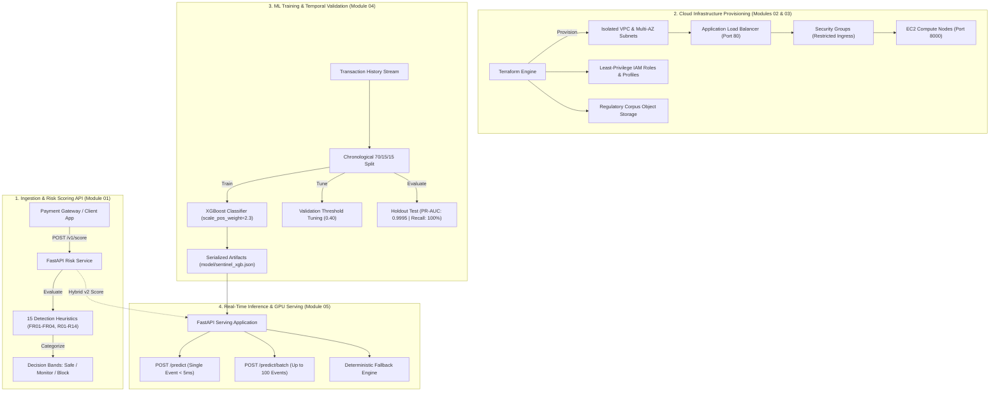

# SENTINEL — Financial Risk & ML Platform

[](https://www.python.org/)
[](https://fastapi.tiangolo.com/)
[](https://www.terraform.io/)
[](https://aws.amazon.com/)
[](https://www.docker.com/)
[](https://xgboost.readthedocs.io/)
[](LICENSE)

An enterprise-grade financial risk scoring and fraud detection platform. **Sentinel** integrates real-time heuristic rule evaluation, gradient-boosted machine learning inference, declarative multi-cloud infrastructure provisioning, and containerized deployment automation.

---

## Executive Architecture & System Overview

Sentinel bridges the gap between streaming payment event analysis and automated cloud infrastructure management. Designed for financial technology and gaming platforms handling high-velocity transactions, the platform combines low-latency deterministic rules with an **XGBoost** model trained on sequential transaction histories.



---

## Platform Capabilities Matrix

| Module | Core Responsibility | Key Technologies | Validation Status |
| :--- | :--- | :--- | :---: |
| [**01-risk-api**](01-risk-api/README.md) | Real-time rule evaluation (15 heuristics), decision banding (`Safe`, `Monitor`, `Block`), SHA-256 file hashing | FastAPI, Pydantic, Uvicorn, Docker | **100% Passed (6/6)** |
| [**02-infra-aws**](02-infra-aws/README.md) | Multi-AZ VPC, ALB load balancing, EC2 container bootstrap, least-privilege IAM policies | Terraform, AWS (VPC, EC2, ALB, IAM) | **Planned (22 Resources)** |
| [**03-multi-cloud**](03-multi-cloud/README.md) | Cross-cloud service mapping, compliance corpus storage, expiring presigned URL generation | Boto3, AWS S3/EC2, Azure/GCP Service Maps | **100% Passed (3/3)** |
| [**04-model-training**](04-model-training/README.md) | Temporal 70/15/15 split, gradient boosting with imbalance weighting, PR-AUC holdout evaluation | XGBoost, scikit-learn, pandas, NumPy | **PR-AUC: 0.9995** |
| [**05-model-serving**](05-model-serving/README.md) | Low-latency inference serving, batch prediction, GPU VM provisioning, automated teardown | FastAPI, XGBoost runtime, Boto3, Docker | **100% Passed (5/5)** |

---

## Machine Learning & Benchmark Metrics

Financial transaction fraud requires specialized handling of sequential data and extreme class imbalance. Sentinel enforces a strict **chronological train/validation/holdout split (70/15/15)** to eliminate future label leakage.

```
Chronological Sequence:
[======================= Train (70%) =======================][==== Val (15%) ====][=== Holdout (15%) ===]
                     Gradient Optimization                     Threshold Tuning        Simulated Production
```

### Holdout Evaluation vs. Static Rules Baseline

On a held-out test set evaluated exactly once, the trained XGBoost model significantly outperforms static rule heuristics:

| Metric | XGBoost Model (Threshold: 0.40) | Heuristic Rules Baseline | Impact Analysis |
| :--- | :---: | :---: | :--- |
| **PR-AUC** | **0.9995** | — | High class separation under imbalance |
| **Accuracy** | **99.73%** | 86.00% | Eliminates heuristic false alarms |
| **Precision** | **98.77%** | 100.00% | Minimizes genuine customer purchase friction |
| **Recall** | **100.00%** | 28.57% | **Catches 100% of holdout fraud (0 false negatives)** |
| **F1 Score** | **0.9938** | 0.4444 | Robust operational balance |

---

## Sanitized Project Structure

```
sentinel-risk-platform/
├── LICENSE                          # Standard MIT open-source license
├── README.md                        # Platform documentation & portfolio showcase
├── .gitignore                       # Multi-tier exclusion for secrets, state & raw data
├── 01-risk-api/                     # Real-time transaction scoring service
│   ├── README.md                    # Module architecture & endpoint specs
│   ├── validate_module01.py         # Automated API validation test suite
│   ├── main.tf                      # Local container orchestration with Terraform
│   └── app/
│       ├── main.py                  # FastAPI implementation (15 risk rules)
│       ├── Dockerfile               # Production container definition
│       └── requirements.txt         # Pinned API dependencies
├── 02-infra-aws/                    # AWS production cloud infrastructure
│   ├── README.md                    # Infrastructure topology & deployment guide
│   ├── alb.tf                       # Application Load Balancer & health probes
│   ├── compute.tf                   # EC2 compute, user data & AMI selection
│   ├── vpc.tf                       # Multi-AZ VPC, subnets & route tables
│   ├── security.tf                  # Layered security groups & IAM roles
│   ├── variable.tf                  # Infrastructure parameters & AMI override
│   ├── outputs.tf                   # ALB endpoint & generated API key outputs
│   ├── terraform.tfvars.example     # Non-sensitive variables template
│   └── .env.example                 # Cloud credentials template
├── 03-multi-cloud/                  # Multi-cloud mapping & compliance corpus
│   ├── README.md                    # Multi-cloud architecture guide
│   ├── service-map.md               # AWS, Azure & GCP cross-cloud service map
│   ├── sentinel_cloud.py            # S3 corpus & EC2 family operations script
│   ├── validate_module03.py         # Automated STS & corpus lifecycle suite
│   ├── requirements.txt             # Cloud SDK dependencies (boto3)
│   └── sentinel_corpus/             # Regulatory standards & investigator playbooks
├── 04-model-training/               # Machine learning engineering pipeline
│   ├── README.md                    # Model training methodology & leakage prevention
│   ├── train.py                     # Training pipeline & holdout evaluation
│   ├── test_model.py                # Model vs. rules benchmark runner
│   ├── sentinel_data.py             # Feature engineering & temporal split
│   ├── sentinel_model.py            # XGBoost wrapper with PR-AUC metric
│   ├── sentinel_rules.py            # Heuristic rules engine baseline
│   ├── data/generate_data.py        # Synthetic transaction dataset generator
│   └── model/
│       ├── sentinel_xgb.json        # Serialized gradient boosted model
│       └── metrics.json             # Model metadata & tuned threshold
└── 05-model-serving/                # Model inference & cloud deployment
    ├── README.md                    # Serving architecture & latency discussion
    ├── validate_module05.py         # Automated serving validation test suite
    ├── sentinel_deploy.py           # Automated cloud deployment script (--dry-run)
    ├── main.tf                      # GPU VM cloud infrastructure
    └── app/
        ├── main.py                  # Serving FastAPI app (single & batch)
        ├── Dockerfile               # Multi-stage non-root container definition
        └── requirements.txt         # Inference server dependencies
```

---

## Quickstart & Local Setup

### 1. Prerequisites
* **Python 3.10+** (tested on 3.11)
* **Docker & Docker Compose**
* **Terraform 1.5+**
* **AWS CLI** (optional, for live cloud deployments)

### 2. Python Virtual Environment Setup
```bash
# Clone the repository
git clone https://github.com/pavanmajji18/sentinel-risk-platform.git
cd sentinel-risk-platform

# Create dedicated virtual environment
python -m venv .venv

# Activate virtual environment
# On Linux/macOS:
source .venv/bin/activate
# On Windows (PowerShell):
.venv\Scripts\Activate.ps1

# Install core dependencies across modules
pip install fastapi uvicorn pydantic python-dotenv requests xgboost scikit-learn numpy pandas boto3
```

### 3. Environment Variable Configuration
Sentinel isolates credentials through environment variable templates. Never commit `.env` or `terraform.tfvars`:
```bash
# Configure AWS Infrastructure module
cp 02-infra-aws/.env.example 02-infra-aws/.env
cp 02-infra-aws/terraform.tfvars.example 02-infra-aws/terraform.tfvars

# Configure Multi-Cloud module
cp 03-multi-cloud/.env.example 03-multi-cloud/.env

# Configure Model Serving module
cp 05-model-serving/app/.env.example 05-model-serving/app/.env
```

---

## Reproducibility & Step-by-Step Verification

Each module contains dedicated validation scripts and reproducible entry points:

### Step 1: Validate Module 01 (Risk API)
```bash
python 01-risk-api/validate_module01.py
```
*Executes tests against health probes, API key enforcement, and clean/moderate/high risk boundary transactions.*

### Step 2: Validate Module 02 (AWS Infrastructure)
```bash
cd 02-infra-aws
terraform init
terraform validate
terraform plan
cd ..
```
*Validates declarative syntax and dry-runs resource planning for 22 interconnected cloud resources.*

### Step 3: Validate Module 03 (Multi-Cloud Operations)
```bash
cd 03-multi-cloud
python validate_module03.py
cd ..
```
*Verifies live STS identity, S3 API reachability, and regulatory corpus upload/presigning lifecycle.*

### Step 4: Train & Benchmark Module 04 (Model Training)
```bash
cd 04-model-training
python train.py
python test_model.py
cd ..
```
*Generates synthetic transactions, executes chronological temporal splitting, trains XGBoost, tunes the decision threshold, and verifies agreement with the rules baseline.*

### Step 5: Validate Module 05 (Model Serving)
```bash
cd 05-model-serving
python validate_module05.py
python sentinel_deploy.py --dry-run
cd ..
```
*Tests live model loading, sub-5ms single prediction, batch prediction, and verifies cloud deployment dry-run logic.*

---

## Security, Privacy & Compliance Safeguards

* **Zero Sensitive Data Exposure:** All training sets, mock payloads, and test cases utilize synthetic data generated via pseudorandom distributions (`numpy.random.default_rng(42)`). No personally identifiable information (PII) or proprietary client records are present.
* **Strict Credential Abstraction:** All cloud access keys, database passwords, and API secrets are ingested exclusively via environment variables. `*.env`, `*.tfvars`, and `*.tfstate` are permanently excluded via root and module `.gitignore` rules.
* **Least-Privilege Cloud Architecture:** IAM instance profiles and policies grant narrow permissions for specific actions (`s3:GetObject`, `s3:ListBucket`, `logs:*`), avoiding broad administrator privileges.
* **Network Boundary Defense:** Compute nodes reside behind Application Load Balancers and restrict direct ingress. Port 8000 is accessible only from verified security groups.

---

## License

This project is licensed under the open-source **MIT License** — see the [LICENSE](LICENSE) file for complete details:

```
MIT License
Copyright (c) 2026 Pavan Majji

Permission is hereby granted, free of charge, to any person obtaining a copy
of this software and associated documentation files (the "Software"), to deal
in the Software without restriction, including without limitation the rights
to use, copy, modify, merge, publish, distribute, sublicense, and/or sell
copies of the Software, and to permit persons to whom the Software is
furnished to do so.
```
